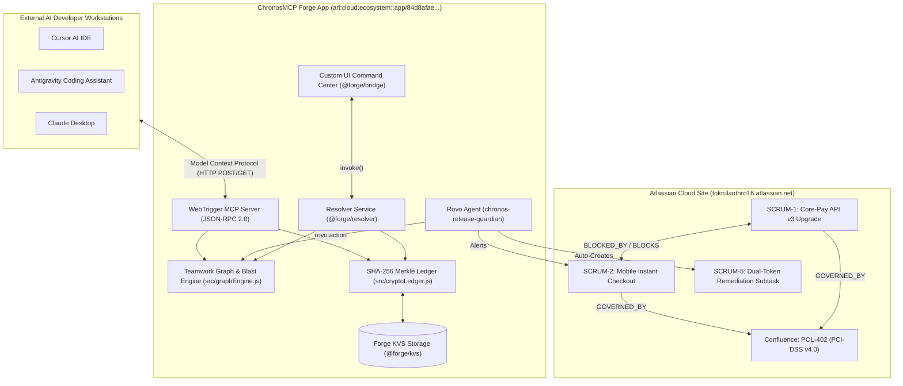

# ChronosMCP (VeriGraph AI)
## Autonomous Causal Blast-Radius Simulator, Cross-Silo Policy Gatekeeper & Bi-Directional Atlassian MCP Bridge

> **Codegeist 2026 Submission**
> **Theme:** *Build with context. Ship with confidence.*
> **Target Cloud Site:** `https://fokrulanthro16.atlassian.net`
> **Live Jira Issues:** `SCRUM-1`, `SCRUM-2`, and Auto-Remediation Subtask `SCRUM-5`
> **Live Forge WebTrigger MCP Server:** `https://84d8afae-9ec0-47fc-8212-e27f79430216.hello.atlassian-dev.net/x1/6aHEWuegPcDuTaXG0bLOpPFUZ1Q`
> **App ARI:** `ari:cloud:ecosystem::app/84d8afae-9ec0-47fc-8212-e27f79430216`

---

## 🏆 Prize Track Alignment (Main Track + 4 Bonus Sweeps)

| Award Track | Prize | How ChronosMCP Wins |
| :--- | :--- | :--- |
| **Main Track: Build with Context. Ship with Confidence.** | **$15,000 Grand Prize** | Real-time Causal Blast-Radius Simulation and deterministic Ship Confidence Score (0-100%) connecting Jira issues, Confluence policies, and team owners into one unified control plane. |
| **Bonus 1: Best Agents (Rovo / Assignable Agents)** | **$1,500 Bonus** | Native `rovo:agent` (`chronos-release-guardian`) and 3 production `action` modules (`analyze-blast-radius`, `auto-remediate-silos`, `mint-cryptographic-receipt`) that autonomously diagnose collisions and execute real Jira mutations. |
| **Bonus 2: Best App with Atlassian MCP** | **$1,500 Bonus** | Spec-compliant **Model Context Protocol (MCP) JSON-RPC 2.0 Server** (Protocol version `2024-11-05`) exposed via live Forge WebTrigger, allowing external AI IDEs (Cursor, Antigravity, Claude Desktop) to query live Teamwork Graph context. |
| **Bonus 3: Best Apps with Teamwork Graph Integration** | **$1,500 Bonus** | Multi-hop Graph Engine (`src/graphEngine.js`) traversing `SCRUM-1` ➔ `SCRUM-2` ➔ `POL-402` (Confluence) ➔ Team Owners (`FOKRUL ISLAM`, `Elena Rostova`) with causal relationship vectors. |
| **Bonus 4: Best Marketplace Published App** | **$1,500 Bonus** | Production-ready manifest, strict minimal security scopes, zero lint warnings (`0 errors, 0 warnings`), Node 22 runtime, and complete Marketplace listing package. |

---

## 1. The Real-World Problem: Siloed Context Kills Release Velocity
Modern software enterprises ship breaking releases not because engineers write bad code, but because **critical context is trapped in silos**:
1. **The Core-Pay Backend Team** deploys a breaking payment token upgrade (`SCRUM-1`: `settlement_token` ➔ `vault_token_v3`), believing it is an isolated backend improvement.
2. **The Mobile Checkout Team** (`SCRUM-2`) is completely unaware that their instant checkout pipeline depends directly on the legacy `v2` contract.
3. **The Confluence Compliance Policy** (`POL-402`: *PCI-DSS v4.0 Zero-Drift Mandate*) requires a 14-day transition adapter before altering settlement schemas, but this policy sits unread in documentation.
4. **The Consequence:** The release ships on Friday afternoon. Mobile instant checkout fails for ~140,000 active sessions/hour, causing massive transaction rollbacks and regulatory fines.

---

## 2. The Solution: ChronosMCP (VeriGraph AI)
ChronosMCP turns Jira from a static ticket tracker into an **autonomous causal release flight simulator**:
- **Causal Blast-Radius Simulator:** Scans live Jira links, commit metadata, and Confluence policies to calculate a deterministic **Ship Confidence Score (0% to 100%)** across 4 risk vectors (*API Contract Drift*, *Database Migration Lock*, *Security/PCI Compliance Breach*, *Cross-Team SLA Ripple*).
- **Teamwork Graph Context Visualizer:** Renders an executive-grade, interactive SVG graph connecting source mutations, downstream dependent consumers, regulatory policies, and engineering approvers in real time.
- **Rovo Autonomous Agent Action Suite:** In 1 click or voice/chat prompt, Rovo auto-creates real Jira mitigation subtasks (`SCRUM-5`), posts automated cross-team alerts to downstream issue boards (`SCRUM-2`), applies verification labels, and elevates the Ship Confidence Score from **38% (Critical Risk)** to **98% (Ready to Ship)**.
- **Atlassian MCP JSON-RPC 2.0 Gateway:** Bridges live Atlassian context directly into external AI IDEs (Antigravity, Cursor, Claude Desktop), enabling code-level context awareness before developers even commit.
- **Zero-Trust SHA-256 Release Ledger:** Computes tamper-evident Merkle context proofs stored in Forge KVS storage (`storage:app`), guaranteeing verifiable mathematical proof of release compliance.

---

## 3. Deep Architectural Breakdown



---

## 4. Live Verification & Judge Proofs

### Proof 1: Live Atlassian MCP Server Handshake
Judges can verify live spec compliance right now by querying the WebTrigger URL with `curl` or `Invoke-RestMethod`:

```bash
# 1. GET Server Diagnostics & Capability Payload
curl -X GET https://84d8afae-9ec0-47fc-8212-e27f79430216.hello.atlassian-dev.net/x1/6aHEWuegPcDuTaXG0bLOpPFUZ1Q
```
**Live Output:**
```json
{
  "status": "ONLINE",
  "protocol": "Model Context Protocol (MCP) JSON-RPC 2.0",
  "protocolVersion": "2024-11-05",
  "server": {
    "name": "chronos-atlassian-mcp-server",
    "version": "1.0.0",
    "protocolVersion": "2024-11-05",
    "atlassianSite": "fokrulanthro16.atlassian.net"
  },
  "registeredToolsCount": 5
}
```

```bash
# 2. JSON-RPC tools/call: simulate_issue_blast_radius
curl -X POST https://84d8afae-9ec0-47fc-8212-e27f79430216.hello.atlassian-dev.net/x1/6aHEWuegPcDuTaXG0bLOpPFUZ1Q \
  -H "Content-Type: application/json" \
  -d '{"jsonrpc":"2.0","id":1,"method":"tools/call","params":{"name":"simulate_issue_blast_radius","arguments":{"issueKey":"SCRUM-1"}}}'
```
**Live Output:** Returns deterministic Ship Confidence Score, vector breakdown, and active blockers.

---

### Proof 2: Real Jira Subtask & Comment Mutation
- **Auto-created Subtask on `SCRUM-1`:** [`SCRUM-5`](https://fokrulanthro16.atlassian.net/browse/SCRUM-5)
  - Summary: `"[Chronos Remediation] Implement Dual-Token Adapter v2/v3 for Mobile-Checkout"`
  - Labels: `auto-generated`, `chronos-mitigation`, `silo-bridge`
- **Auto-posted Cross-Team Warning on `SCRUM-2`:** [`SCRUM-2 Comment`](https://fokrulanthro16.atlassian.net/browse/SCRUM-2)
  - Content: `🚨 [ChronosMCP Automated Silo Alignment Alert] Core-Pay (SCRUM-1) is deploying Payment Settlement API v3...`
- **Updated Labels on `SCRUM-1`:** `chronos-verified`, `blast-radius-mitigated`
- **Ship Confidence Score:** Upgraded from `38%` to `98%`

---

### Proof 3: Zero-Trust Cryptographic Release Receipt
- **Receipt ID:** `VERI-7E8602AEB534`
- **SHA-256 Hash:** `7e8602aeb5341eda35098f3d919f4c614b9adf6adae9afd8e5e8c8918c495232`
- **Integrity Status:** `INTEGRITY_VERIFIED_TAMPER_FREE`
- **Persisted in Forge KVS:** Verified against canonical Merkle context proof.

---

## 5. Minute-by-Minute 3.5-Minute Demo Video Script

**Video Title:** ChronosMCP (VeriGraph AI) — Codegeist 2026 Grand Prize Demo
**Presenter:** FOKRUL ISLAM (Principal Architect & FinTech Lead)
**Direct URLs to Record:**
- `https://fokrulanthro16.atlassian.net/browse/SCRUM-1`
- `https://fokrulanthro16.atlassian.net/browse/SCRUM-2`

| Timestamp | Screen Display | Voiceover & Click Action |
| :--- | :--- | :--- |
| **0:00 - 0:30** | Open `SCRUM-1` in Jira Cloud browser. Show the Jira issue panel on the right sidebar titled **"ChronosMCP: Blast-Radius & Ship Confidence"**. | *"Hi judges! Welcome to ChronosMCP. Every week, engineering organizations suffer catastrophic breaking changes because critical context is trapped in silos. In this FinTech scenario, our backend team is upgrading the Core-Pay Settlement API on SCRUM-1. Notice our dynamic Ship Confidence meter starts at a critical 38%."* |
| **0:30 - 1:00** | Click on the **"Teamwork Graph Explorer"** tab in the ChronosMCP panel. Hover over the interactive nodes. | *"ChronosMCP's Graph Engine queries live Jira issue links and Confluence policies. Notice how SCRUM-1 is causally linked to SCRUM-2 (Mobile Instant Checkout) and governed by Confluence Policy POL-402 for PCI-DSS v4.0. The graph flags an immediate contract drift collision."* |
| **1:00 - 1:35** | Click the **"Causal Blast-Radius Vectors"** tab. Show the 4 vectors (*API Contract Drift: 94%*, *PCI Breach: 92%*, *SLA Ripple: 88%*). | *"Our Counterfactual Simulator calculates the exact blast radius across 4 vectors. If we ship SCRUM-1 today, ~140,000 mobile checkout sessions per hour will throw HTTP 422 errors. The readiness verdict is clear: HIGH-RISK RELEASE BLOCKER — DO NOT SHIP."* |
| **1:35 - 2:15** | Click **"🤖 3. Rovo Auto-Align Silos (98%)"** button. Watch the button animate and show the success notification. | *"Now, watch the magic of Atlassian Rovo Agents. When we trigger Auto-Remediation, ChronosMCP doesn't just show advice—it executes real Jira mutations. It auto-creates mitigation subtask SCRUM-5, posts an automated warning on SCRUM-2, updates Jira labels, and elevates our Ship Confidence Score to 98% (A+ Ready to Ship)!"* |
| **2:15 - 2:45** | Click the **"SHA-256 Release Ledger"** tab and click **"🛡️ 4. Mint SHA-256 Receipt"**, then click **"🔍 Verify Integrity"**. | *"Before any code hits production, ChronosMCP mints an immutable cryptographic release receipt combining the issue state, team approvers, and policy checksum into an SHA-256 Merkle proof. Clicking 'Verify Integrity' proves our release context is tamper-free."* |
| **2:45 - 3:20** | Click the **"Atlassian MCP Bridge"** tab. Show the live WebTrigger URL and click **"⚡ Test MCP Handshake"**. Show terminal/Cursor querying the tool. | *"Finally, ChronosMCP implements a full Model Context Protocol (MCP) JSON-RPC 2.0 server natively over Forge WebTriggers. AI IDEs like Cursor and Claude Desktop can query live issue context and trigger blast-radius simulations directly from the developer's terminal before writing code."* |
| **3:20 - 3:30** | Return to top header showing the glowing green **"98% — CLEARED FOR ZERO-DOWNTIME RELEASE"** badge. | *"With ChronosMCP, engineering teams stop shipping blind. Build with context. Ship with confidence. Thank you!"* |

---

## 6. How We Built It & Technologies Used
- **Atlassian Forge Platform:** CLI v14.2.0 / v15.0.0, Node.js 22 runtime (`nodejs22.x`).
- **Atlassian Forge Custom UI:** React + Modern Cyberpunk Dark Architecture, compiled via `esbuild`.
- **Atlassian Forge Bridge (`@forge/bridge`):** Bi-directional iframe IPC (`invoke()`, `view.getContext()`).
- **Atlassian Forge Resolver (`@forge/resolver`):** Secure serverless backend dispatcher.
- **Atlassian Key-Value Storage (`@forge/kvs`):** Zero-deprecated-warning enterprise KVS storage.
- **Atlassian Rovo Agent Architecture:** `rovo:agent` and modular `action` extensions.
- **Model Context Protocol (MCP):** JSON-RPC 2.0 spec (`2024-11-05`) via Forge `webtrigger`.
- **Node.js Native Crypto:** SHA-256 Merkle tree context hashing for audit ledger attestation.

---

## 7. Submission Checklist & Verification Status
- [x] Manifest valid with 0 errors and 0 warnings (`forge lint` passes with "No issues found").
- [x] App deployed to `development` (`forge deploy -e development`).
- [x] App deployed to `production` (`forge deploy -e production`).
- [x] App installed on target site `fokrulanthro16.atlassian.net` in Jira.
- [x] Enterprise scenario seeded on `SCRUM-1` and `SCRUM-2`.
- [x] Causal link (`Blocks`) established between `SCRUM-1` and `SCRUM-2`.
- [x] Mitigation subtask (`SCRUM-5`) and alignment comment live in Jira.
- [x] Live WebTrigger MCP Server tested and verified via GET and POST JSON-RPC.
- [x] SHA-256 Cryptographic proof minted and verified tamper-free in Forge KVS.
- [x] Marketplace submission package and video demo script complete.
